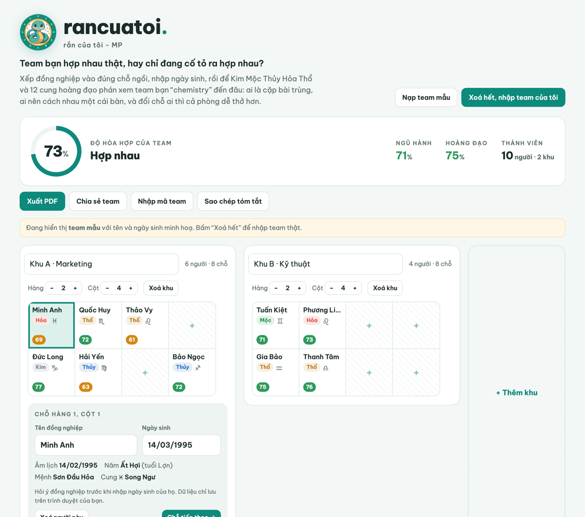
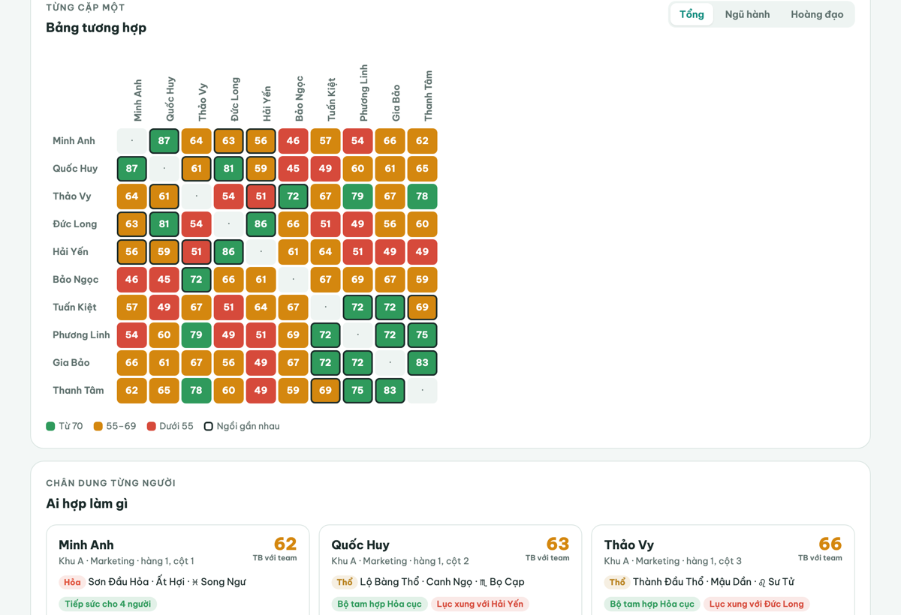
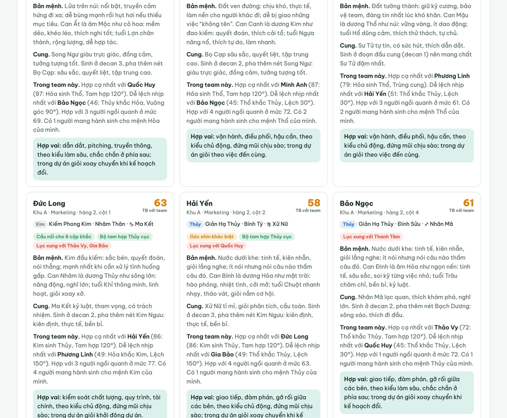

  

<h1 align="center">rancuatoi.</h1>

<b>rắn của tôi · đo độ hợp cạ của team</b>

  <a href="https://rancuatoi.pages.dev"><b>👉 Dùng thử tại rancuatoi.pages.dev</b></a>

---

> **Team bạn hợp nhau thật, hay chỉ đang cố tỏ ra hợp nhau?**
>
> Xếp đồng nghiệp vào đúng chỗ ngồi, nhập ngày sinh, rồi để Kim Mộc Thủy Hỏa Thổ và 12 cung hoàng đạo phán xem team bạn "chemistry" đến đâu: ai là cặp bài trùng, ai nên cách nhau một cái bàn, và đổi chỗ ai thì cả phòng dễ thở hơn.

## Tính năng

- **Sơ đồ chỗ ngồi theo khu**: nhiều khu, mỗi khu là lưới ô vuông, thêm bớt hàng cột tuỳ ý.
- **Ngũ hành can chi**: đổi ngày sinh sang năm âm lịch theo lịch Việt Nam (tính chính xác ngày Tết), tra mệnh nạp âm trong vòng 60 năm Giáp Tý, xét tương sinh tương khắc, tam hợp, lục hợp, lục xung, thiên can hợp xung.
- **Cung hoàng đạo**: chấm theo góc chiếu giữa các cung (tam hợp 120°, vuông góc 90°…), nguyên tố và tính chất.
- **Chỗ ngồi có ý nghĩa**: người ngồi càng gần nhau thì độ hợp của họ càng ảnh hưởng nhiều đến điểm team; có **gợi ý đổi chỗ** để điểm team tăng nhiều nhất.
- **Chân dung từng người**: phân tích riêng theo 30 mệnh nạp âm, thiên can, con giáp, decan của cung và vai trò thực tế trong team.
- **Kết quả cố định**: không ngẫu nhiên, không dùng AI lúc chạy; cùng dữ liệu luôn ra cùng kết quả.
- **Xuất PDF, mã chia sẻ team, tóm tắt để dán vào Zalo/Slack.**

## Quyền riêng tư

Không có máy chủ lưu dữ liệu: tên và ngày sinh chỉ nằm trong trình duyệt của người dùng, mọi phép tính chạy ngay trên máy. Thống kê truy cập dùng Cloudflare Web Analytics (không cookie) và Google Analytics chỉ khi người dùng đồng ý.

## Công nghệ

Web tĩnh một trang (HTML, CSS, JavaScript thuần), lịch âm Việt Nam theo thuật toán thiên văn, triển khai trên Cloudflare Pages.

---

  Made by <b>MinhPhuc</b> · <a href="https://github.com/mphuc1204-star">@mphuc1204-star</a> 
  Mã nguồn được giữ riêng tư. Repo này là trang giới thiệu và chuyển hướng <code>rancuatoi.github.io</code> sang web chính.

